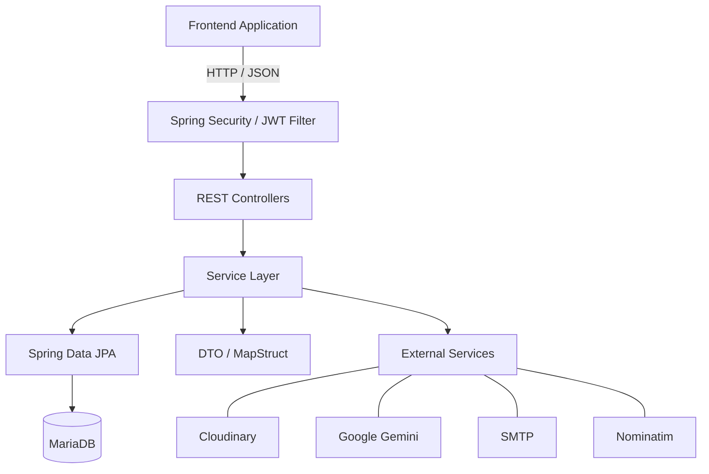
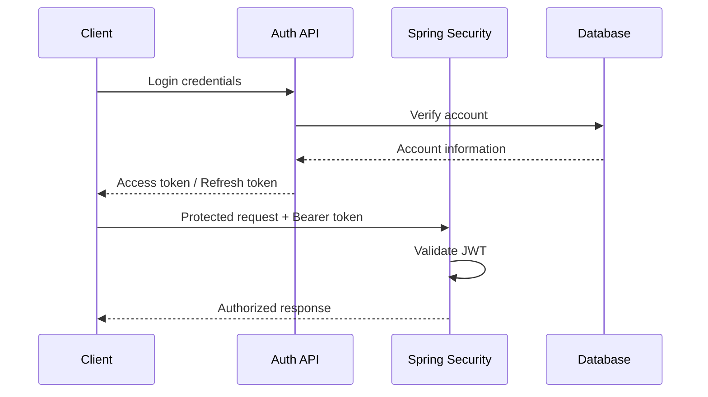

<div align="center">

# HOVERSE — BACKEND API

**Backend service cho nền tảng khám phá địa điểm và chia sẻ trải nghiệm tại TP.HCM**

*Location discovery · Community reviews · Role-based access · AI-assisted recommendations*

[](./pom.xml)
[](./pom.xml)
[](./pom.xml)
[](./pom.xml)
[](./Dockerfile)

**[Website](https://hoverse.pro.vn)** · **[Architecture](#system-architecture)** · **[API](#api-documentation)** · **[Development Guide](#development-guide)**

</div>

---

## Project Overview

Hoverse là nền tảng khám phá địa điểm ăn uống, vui chơi và giải trí, hướng đến cộng đồng người trẻ tại TP.HCM.

Thay vì chỉ cung cấp thông tin địa điểm, Hoverse hướng đến việc xây dựng một cộng đồng nơi người dùng có thể khám phá, đánh giá, lưu lại và chia sẻ những địa điểm phù hợp với sở thích cá nhân.

Repository này chứa mã nguồn **Backend REST API**, chịu trách nhiệm xử lý nghiệp vụ, xác thực người dùng, quản lý dữ liệu, kiểm soát quyền truy cập và tích hợp các dịch vụ bên ngoài.

Frontend được phát triển và quản lý trong một GitHub repository độc lập.

### Responsibilities

Backend chịu trách nhiệm:

- Cung cấp REST API cho các ứng dụng client.
- Quản lý tài khoản và xác thực người dùng.
- Kiểm soát quyền truy cập vào tài nguyên.
- Quản lý địa điểm, danh mục và thẻ phân loại.
- Xử lý đánh giá và danh sách địa điểm yêu thích.
- Lưu trữ metadata và quản lý hình ảnh.
- Hỗ trợ tìm kiếm, lọc và phân trang.
- Tích hợp dịch vụ gợi ý địa điểm bằng AI.
- Tích hợp dịch vụ geocoding.
- Đảm bảo tính nhất quán của dữ liệu nghiệp vụ.

### Engineering Approach

Dự án được tổ chức theo kiến trúc phân lớp dựa trên Spring Boot.

Các thành phần được phân chia theo trách nhiệm:

- **Controller:** Tiếp nhận HTTP request và trả về response.
- **Service:** Xử lý business logic và điều phối nghiệp vụ.
- **Repository:** Truy cập dữ liệu thông qua Spring Data JPA.
- **Entity:** Biểu diễn dữ liệu quan hệ.
- **DTO:** Định nghĩa dữ liệu trao đổi qua API.
- **Mapper:** Chuyển đổi giữa Entity và DTO.
- **Security:** Xác thực và kiểm soát quyền truy cập.
- **Configuration:** Quản lý cấu hình framework và dịch vụ tích hợp.

Cách tổ chức này giúp hạn chế sự phụ thuộc giữa HTTP layer, business logic và persistence layer.

---

## Key Features

### Authentication & Account Management

- Đăng ký tài khoản.
- Đăng nhập bằng thông tin tài khoản.
- Đăng nhập Google.
- Xác thực email.
- Cấp lại access token bằng refresh token.
- Quản lý thông tin cá nhân.
- Cập nhật ảnh đại diện.
- Đổi mật khẩu.
- Quản lý trạng thái tài khoản.

### Place Management

- Tạo và cập nhật địa điểm.
- Truy xuất danh sách địa điểm.
- Tìm kiếm và lọc địa điểm.
- Phân trang dữ liệu.
- Quản lý trạng thái địa điểm.
- Quản lý hình ảnh địa điểm.
- Cung cấp dữ liệu địa điểm cho bản đồ.
- Thống kê dữ liệu địa điểm.

### Community Features

- Đánh giá địa điểm.
- Quản lý nội dung review.
- Đính kèm hình ảnh review.
- Quản lý trạng thái review.
- Lưu và bỏ lưu địa điểm yêu thích.

### Discovery & Classification

- Quản lý danh mục địa điểm.
- Quản lý thẻ phân loại.
- Tìm kiếm theo các điều kiện lọc.
- Gợi ý địa điểm với Gemini.
- Reverse geocoding với Nominatim.

---

## Technology Stack

| Category | Technology |
|---|---|
| Language | Java 17 |
| Framework | Spring Boot 4.0.6 |
| Web | Spring Web MVC |
| Security | Spring Security |
| Authentication | JWT, JJWT 0.11.5 |
| Persistence | Spring Data JPA, Hibernate |
| Database | MariaDB |
| Mapping | MapStruct 1.6.3 |
| Boilerplate | Lombok |
| HTTP Client | Spring WebFlux WebClient |
| File Storage | Cloudinary |
| AI Integration | Google Gemini |
| Geocoding | OpenStreetMap Nominatim |
| Email | Spring Boot Mail, SMTP |
| Build | Maven Wrapper |
| Containerization | Docker |
| CI/CD | GitHub Actions |
| Testing | Spring Boot Test, JUnit, H2 |

Các phiên bản không được khai báo trực tiếp trong bảng được quản lý thông qua Maven dependency management.

**Runtime compatibility:** `pom.xml` khai báo Java 17, trong khi Dockerfile sử dụng JDK 23. Cần đánh giá và thống nhất runtime khi bảo trì hệ thống.

---

## System Architecture

### High-Level Architecture



### Request Processing

Một request thông thường được xử lý theo luồng:

```text
HTTP Request
    |
    v
Spring Security Filter Chain
    |
    v
REST Controller
    |
    v
Service Layer
    |
    +---- Business Validation
    |
    +---- Authorization / Ownership
    |
    +---- Repository
    |         |
    |         v
    |      MariaDB
    |
    +---- External Services
    |
    v
DTO / Mapper
    |
    v
HTTP Response
```

### Architectural Responsibilities

#### Controller Layer

Controller là điểm tiếp nhận HTTP request.

Trách nhiệm chính:

- Định nghĩa API endpoints.
- Tiếp nhận path variables, query parameters và request body.
- Kích hoạt request validation.
- Truyền dữ liệu đến Service.
- Trả về HTTP response phù hợp.

Controller không nên trực tiếp triển khai business logic phức tạp hoặc truy vấn database.

#### Service Layer

Service chứa logic nghiệp vụ của hệ thống.

Trách nhiệm:

- Kiểm tra business rules.
- Xử lý trạng thái nghiệp vụ.
- Kiểm tra quyền sở hữu tài nguyên.
- Điều phối nhiều Repository.
- Quản lý transaction.
- Tương tác với external services.
- Chuyển đổi dữ liệu thông qua Mapper.

Các thay đổi nghiệp vụ nên được thực hiện tại Service trước khi xem xét điều chỉnh những layer khác.

#### Repository Layer

Repository cung cấp khả năng truy cập dữ liệu thông qua Spring Data JPA.

Bao gồm:

- CRUD operations.
- Derived query methods.
- Custom queries.
- Dynamic filtering thông qua Specification.
- Truy xuất các quan hệ giữa Entity.

Repository không nên chịu trách nhiệm quyết định business rules.

#### DTO & Mapper

DTO định nghĩa dữ liệu được trao đổi giữa Backend và client.

Việc sử dụng DTO giúp:

- Tránh trả trực tiếp JPA Entity.
- Kiểm soát dữ liệu được công khai.
- Hạn chế circular references.
- Tách API contract khỏi database schema.
- Giảm ảnh hưởng khi thay đổi cấu trúc Entity.

MapStruct được sử dụng để hỗ trợ chuyển đổi giữa các kiểu dữ liệu.

---

## Project Structure

```text
.
├── .github/
│   └── workflows/
│       └── deploy.yml
│
├── .mvn/
│   └── wrapper/
│
├── Dockerfile
├── mvnw
├── mvnw.cmd
├── pom.xml
│
└── src/
    ├── main/
    │   ├── java/
    │   │   └── com/hoverse/backend/
    │   │       ├── BackendApplication.java
    │   │       ├── client/
    │   │       ├── config/
    │   │       ├── controller/
    │   │       ├── dto/
    │   │       ├── entity/
    │   │       ├── enums/
    │   │       ├── exception/
    │   │       ├── mapper/
    │   │       ├── repository/
    │   │       │   └── specification/
    │   │       ├── security/
    │   │       └── service/
    │   │           └── impl/
    │   │
    │   └── resources/
    │       ├── application.properties
    │       ├── application-local.properties
    │       └── application-prod.properties
    │
    └── test/
        ├── java/
        │   └── com/hoverse/backend/
        │       └── BackendApplicationTests.java
        └── resources/
            └── application-test.properties
```

### Directory Responsibilities

| Directory | Responsibility |
|---|---|
| `client` | HTTP client dành cho dịch vụ bên ngoài |
| `config` | Security, WebClient và integration configuration |
| `controller` | REST API endpoints |
| `dto` | Request và Response models |
| `entity` | JPA entities |
| `enums` | Trạng thái và kiểu dữ liệu nghiệp vụ |
| `exception` | Custom exceptions và global error handling |
| `mapper` | Entity–DTO mapping |
| `repository` | Database access |
| `repository/specification` | Dynamic query filters |
| `security` | JWT và authentication infrastructure |
| `service` | Service contracts |
| `service/impl` | Business logic implementations |

---

## Core Modules

### Authentication Module

**Main components**

- `AuthController`
- `AuthServiceImpl`
- `JwtAuthFilter`
- `JwtUtils`
- `SecurityConfig`

Module chịu trách nhiệm xác thực danh tính và quản lý vòng đời token.

Access token được sử dụng để xác thực request tới protected endpoints.

Refresh token hỗ trợ cấp lại access token mà không yêu cầu người dùng đăng nhập lại trong mỗi lần access token hết hạn.

Backend sử dụng Spring Security để xử lý authentication và authorization.

### User Module

**Main components**

- `UserController`
- `UserServiceImpl`
- `UserRepository`

Module quản lý thông tin người dùng và các thao tác liên quan đến tài khoản.

Khi mở rộng thông tin profile, cần kiểm tra đồng thời:

1. User Entity.
2. Request/Response DTO.
3. Mapper.
4. User Service.
5. Database schema.
6. Frontend API contract.

Không nên bổ sung trường dữ liệu nhạy cảm vào response DTO nếu client không thực sự cần.

### Place Module

**Main components**

- `PlaceController`
- `PlaceServiceImpl`
- `PlaceRepository`
- `PlaceSpecification`

Đây là một trong những domain trung tâm của hệ thống.

Module chịu trách nhiệm quản lý dữ liệu địa điểm, tìm kiếm, lọc, cập nhật trạng thái và cung cấp thông tin cho các tính năng khám phá.

`PlaceSpecification` hỗ trợ xây dựng điều kiện truy vấn động.

Khi bổ sung bộ lọc mới, cần kiểm tra:

- Kiểu dữ liệu đầu vào.
- Điều kiện lọc.
- Kết hợp nhiều tiêu chí.
- Phân trang và sắp xếp.
- Query performance.
- Database indexing.
- Tính tương thích với frontend.

### Review Module

**Main components**

- `ReviewController`
- `ReviewServiceImpl`

Module quản lý đánh giá của người dùng đối với địa điểm.

Các thay đổi nghiệp vụ cần chú ý đến:

- Người tạo review.
- Quyền chỉnh sửa và xóa.
- Trạng thái review.
- Quan hệ với địa điểm.
- Hình ảnh đính kèm.
- Ảnh hưởng đến thống kê đánh giá.

### Favorite Module

**Main components**

- `PlaceFavoriteController`
- `PlaceFavoriteServiceImpl`

Module hỗ trợ người dùng lưu và quản lý địa điểm yêu thích.

Khi sửa đổi logic, cần đảm bảo không tạo dữ liệu yêu thích trùng lặp ngoài ý muốn và kiểm soát đúng quyền truy cập theo người dùng.

### Category & Tag Modules

Hai module hỗ trợ phân loại địa điểm.

Category thể hiện nhóm phân loại chính, trong khi Tag cung cấp các nhãn bổ sung để mô tả và lọc dữ liệu.

Khi thay đổi Category hoặc Tag, cần xem xét ảnh hưởng đến các truy vấn lọc địa điểm.

### AI Recommendation Module

**Main components**

- `GeminiController`
- `GeminiServiceImpl`
- `AIPlaceSpecification`

Module tích hợp Gemini để hỗ trợ gợi ý địa điểm.

Khi bảo trì cần kiểm tra:

- Input validation.
- Prompt construction.
- API authentication.
- Timeout.
- Rate limits và quota.
- Xử lý response không hợp lệ.
- Cơ chế fallback khi external API thất bại.

Không nên xem kết quả từ mô hình AI là dữ liệu đã được xác minh nếu chưa có bước kiểm tra tương ứng.

### Geocoding Module

**Main components**

- `NominatimController`
- `NominatimServiceImpl`
- `NominatimClient`

Module hỗ trợ reverse geocoding, chuyển đổi tọa độ thành thông tin địa chỉ.

Khi mở rộng, cần tuân thủ chính sách sử dụng của Nominatim và kiểm soát tần suất request.

---

## Database Design

Hệ thống sử dụng MariaDB kết hợp Spring Data JPA.

JPA Entity định nghĩa ánh xạ giữa Java objects và các bảng dữ liệu quan hệ.

### Data Modeling Principles

Khi thay đổi database, cần xem xét:

- Primary key.
- Foreign key.
- Unique constraints.
- Nullable constraints.
- Column precision.
- Indexes.
- Entity relationships.
- Cascade operations.
- Transaction boundaries.

### Geographic Coordinates

Dữ liệu tọa độ cần được lưu với độ chính xác phù hợp để tránh sai lệch vị trí trên bản đồ.

Khi thay đổi kiểu dữ liệu latitude hoặc longitude, cần kiểm tra đồng thời:

- Database column definition.
- Entity field type.
- Request DTO.
- Response DTO.
- Validation.
- Serialization.
- Dữ liệu đã tồn tại.

### Schema Management

Cấu hình hiện tại sử dụng:

```properties
spring.jpa.hibernate.ddl-auto=update
```

Cấu hình này thuận tiện trong giai đoạn phát triển nhưng không phải phương án quản lý schema lý tưởng cho production.

**Recommended approach**

Sử dụng Flyway hoặc Liquibase để quản lý migration theo phiên bản.

Quy trình đề xuất:

1. Tạo migration script.
2. Review thay đổi schema.
3. Backup database.
4. Chạy migration trên môi trường thử nghiệm.
5. Kiểm tra compatibility với phiên bản ứng dụng hiện tại.
6. Triển khai theo kế hoạch.
7. Xác minh dữ liệu sau migration.

Flyway và Liquibase là đề xuất cải tiến, không phải dependency đã được xác minh trong repository.

---

## Installation & Setup

### Prerequisites

Cần chuẩn bị:

- JDK tương thích Java 17.
- MariaDB.
- Git.
- Maven Wrapper có sẵn trong repository.
- Các environment variables cần thiết.

### Clone Repository

```bash
git clone https://github.com/ntphoang/Project_Hoverse_Backend.git

cd Project_Hoverse_Backend
```

### Configure Database

Profile local sử dụng MariaDB tại:

```text
jdbc:mariadb://localhost:3306/hoverse_db?createDatabaseIfNotExist=true
```

Cần đảm bảo MariaDB đang hoạt động và tài khoản kết nối có quyền phù hợp.

Không sử dụng production database khi chạy ứng dụng local.

### Run Application

**Windows PowerShell**

```powershell
.\mvnw.cmd spring-boot:run "-Dspring-boot.run.profiles=local"
```

**Linux / macOS**

```bash
./mvnw spring-boot:run -Dspring-boot.run.profiles=local
```

Backend sử dụng port mặc định `8088` khi không cấu hình `PORT`.

Local API:

```text
http://localhost:8088
```

Việc khởi động thành công còn phụ thuộc vào các cấu hình database, JWT, email và external integrations.

---

## Environment Configuration

Cấu hình được quản lý thông qua Spring Boot properties và environment variables.

### Application Profiles

| Profile | Purpose |
|---|---|
| `local` | Local development |
| `prod` | Production configuration |
| `test` | Automated testing |

### Environment Variables

| Variable | Description |
|---|---|
| `PORT` | Application HTTP port |
| `DATABASE_URL` | Production JDBC connection URL |
| `LOCAL_DB_PASSWORD` | Local database password |
| `DATABASE_USERNAME` | Production database username |
| `DATABASE_PASSWORD` | Production database password |
| `MAIL_USERNAME` | SMTP username |
| `MAIL_PASSWORD` | SMTP password |
| `CLOUDINARY_API_KEY` | Cloudinary API key |
| `CLOUDINARY_API_SECRET` | Cloudinary API secret |
| `GEMINI_API_KEY` | Gemini API key |
| `JWT_SECRET` | JWT signing secret |
| `JWT_EXPIRATION` | Access token expiration |
| `JWT_REFRESH_EXPIRATION` | Refresh token expiration |
| `GOOGLE_CLIENT_ID` | Google authentication client ID |
| `FRONTEND_URL` | Frontend URL configuration |
| `SPRING_PROFILES_ACTIVE` | Active Spring profile |

Các giá trị và đơn vị thời gian phải được đối chiếu với configuration và code sử dụng tương ứng.

### Security Requirements

Không commit:

- `.env`
- Database credentials.
- JWT signing secrets.
- API keys.
- SMTP credentials.
- Cloud provider credentials.

Production secrets nên được quản lý thông qua cơ chế environment injection hoặc secret management phù hợp.

Nếu một secret đã xuất hiện trong Git history công khai, cần rotate secret thay vì chỉ xóa khỏi phiên bản code mới.

---

## Development Guide

Phần này mô tả quy trình bảo trì và mở rộng Backend.

### Adding a New API

Khi triển khai một API mới, nên thực hiện theo trình tự:

**Step 1 — Define Requirements**

Xác định:

- API giải quyết nghiệp vụ gì?
- Ai được phép gọi?
- Request cần dữ liệu nào?
- Response cần trả dữ liệu nào?
- Những trường hợp lỗi có thể xảy ra?

**Step 2 — Define DTO**

Tạo request/response DTO phù hợp.

Áp dụng validation cho dữ liệu đầu vào.

**Step 3 — Implement Business Logic**

Bổ sung phương thức vào Service và triển khai tại Service implementation.

Đặt business rules tại Service thay vì Controller.

**Step 4 — Update Persistence**

Chỉ thay đổi Repository hoặc Entity khi nghiệp vụ thực sự yêu cầu.

**Step 5 — Expose Endpoint**

Định nghĩa route tại Controller.

Controller nên giữ vai trò điều phối request và response.

**Step 6 — Configure Security**

Kiểm tra:

- Endpoint public hay protected?
- Có yêu cầu role cụ thể không?
- Có cần kiểm tra quyền sở hữu tài nguyên không?

**Step 7 — Add Tests**

Kiểm thử:

- Successful requests.
- Invalid input.
- Unauthorized requests.
- Forbidden operations.
- Resource not found.
- Business rule violations.

**Step 8 — Update Documentation**

Cập nhật API contract và tài liệu liên quan.

### Modifying an Existing Business Feature

Ví dụ: thay đổi điều kiện tìm kiếm địa điểm.

Quy trình:

```text
Requirement
    |
    v
Controller Request Parameters
    |
    v
Service Business Logic
    |
    v
Specification / Repository
    |
    v
Database Query
    |
    v
Response DTO
    |
    v
Frontend Integration
```

Không phải mọi thay đổi đều cần chỉnh sửa tất cả các layer.

Chỉ sửa những thành phần có trách nhiệm trực tiếp với yêu cầu.

### Maintenance Lookup

| Requirement | Start Here |
|---|---|
| Login / Registration | `AuthController`, `AuthServiceImpl` |
| JWT authentication | `security/`, `SecurityConfig` |
| User profile | `UserController`, `UserServiceImpl` |
| Place CRUD | `PlaceController`, `PlaceServiceImpl` |
| Place filtering | `PlaceSpecification` |
| Review operations | `ReviewController`, `ReviewServiceImpl` |
| Favorites | `PlaceFavoriteServiceImpl` |
| AI recommendation | `GeminiServiceImpl` |
| Reverse geocoding | `NominatimClient`, `NominatimServiceImpl` |
| Database queries | `repository/` |
| API request/response | `dto/`, `mapper/` |
| Exception handling | `exception/` |
| CORS configuration | `WebConfig` |
| Deployment | `Dockerfile`, `.github/workflows/deploy.yml` |

### Code Review Checklist

Trước khi merge một thay đổi:

- [ ] Business logic được đặt đúng layer.
- [ ] API contract không bị thay đổi ngoài dự kiến.
- [ ] Không trả về dữ liệu nhạy cảm.
- [ ] Authentication và authorization được kiểm tra.
- [ ] Database queries được đánh giá.
- [ ] Transaction boundaries phù hợp.
- [ ] Các trường hợp lỗi được xử lý.
- [ ] Tests liên quan được cập nhật.
- [ ] Không commit credentials.
- [ ] Documentation phản ánh thay đổi.

---

## API Documentation

Backend cung cấp các REST API với prefix:

```text
/api/v1
```

Các domain API được tổ chức thông qua Controller tương ứng.

| Domain | Controller | Responsibility |
|---|---|---|
| Authentication | `AuthController` | Login, registration, token lifecycle |
| Users | `UserController` | Profile and account management |
| Places | `PlaceController` | Place management and discovery |
| Reviews | `ReviewController` | Reviews and moderation |
| Favorites | `PlaceFavoriteController` | Favorite places |
| Categories | Category Controller | Place categories |
| Tags | Tag Controller | Place tags |
| AI | `GeminiController` | AI recommendations |
| Geocoding | `NominatimController` | Reverse geocoding |

### API Design Considerations

Khi bổ sung hoặc thay đổi endpoint:

- Sử dụng HTTP method phù hợp.
- Giữ naming convention nhất quán.
- Áp dụng validation tại request boundary.
- Trả HTTP status phản ánh kết quả xử lý.
- Không expose JPA Entity trực tiếp khi không cần thiết.
- Giữ backward compatibility khi có client đang sử dụng.
- Tránh thay đổi response structure mà không cập nhật frontend.

Danh sách HTTP method, path và payload chi tiết cần được duy trì trực tiếp từ Controller hoặc OpenAPI specification để tránh sai lệch khi code thay đổi.

---

## Authentication & Security

### Authentication Architecture

Hệ thống sử dụng Spring Security kết hợp JWT.



### Access Token

Client sử dụng access token trong HTTP Authorization header:

```http
Authorization: Bearer <access_token>
```

JWT Filter chịu trách nhiệm xử lý token và thiết lập authentication context khi token hợp lệ.

### Refresh Token

Refresh token được sử dụng để hỗ trợ duy trì phiên đăng nhập.

Cơ chế cookie cần được kiểm tra cùng các thuộc tính:

- `HttpOnly`
- `Secure`
- `SameSite`
- `Path`
- Expiration

Khi triển khai trên nhiều domain, cần đánh giá cookie policy, CORS và HTTPS đồng thời.

### Authorization

Hệ thống sử dụng nhiều cấp kiểm soát:

| Layer | Responsibility |
|---|---|
| Security configuration | HTTP access rules |
| JWT Filter | Token authentication |
| Method security | Role-based authorization |
| Service | Resource ownership and business authorization |

Không nên chỉ dựa vào việc frontend ẩn nút hoặc ẩn trang để bảo vệ API.

Authorization phải được thực thi tại Backend.

### CORS

`WebConfig` khai báo các origin được phép truy cập.

Các origin được xác minh trong cấu hình:

```text
http://localhost:5173
http://localhost:3000
http://localhost:4173
https://hoverse-frontend.vercel.app
```

Khi thay đổi frontend domain, cần kiểm tra lại CORS configuration.

Biến `FRONTEND_URL` không tự động thay thế danh sách origin được khai báo trực tiếp trong `WebConfig`.

### Security Considerations

Các hạng mục cần được đánh giá định kỳ:

- JWT expiration và key rotation.
- Refresh token revocation.
- Password hashing.
- Rate limiting cho authentication.
- CSRF khi sử dụng cookie.
- Resource ownership.
- Sensitive data exposure.
- External API credentials.
- Error response information leakage.

---

## Testing

### Current Test Setup

Repository có:

```text
BackendApplicationTests.java
application-test.properties
```

Test hiện tại bao gồm Spring application context loading.

Profile test sử dụng H2 in-memory database.

### Run Tests

**Windows**

```powershell
.\mvnw.cmd test
```

**Linux / macOS**

```bash
./mvnw test
```

### Recommended Test Coverage

| Test Type | Purpose |
|---|---|
| Unit Test | Business logic |
| Repository Test | Database queries |
| Controller Test | HTTP contract |
| Security Test | Authentication and authorization |
| Integration Test | End-to-end backend workflows |

### Priority Test Scenarios

Nên ưu tiên kiểm thử:

1. Registration và login.
2. JWT expiration và refresh.
3. Role-based authorization.
4. Resource ownership.
5. Place creation và updates.
6. Review permissions.
7. Favorite uniqueness.
8. Dynamic filtering.
9. Transaction rollback.
10. External service failure handling.

Bộ kiểm thử hiện tại chưa đủ bằng chứng để khẳng định toàn bộ nghiệp vụ đã được tự động kiểm chứng.

---

## Build & Deployment

### Maven Build

```bash
./mvnw clean package
```

Artifact:

```text
target/backend-0.0.1-SNAPSHOT.jar
```

### Run Packaged Application

```bash
java -jar target/backend-0.0.1-SNAPSHOT.jar
```

### Docker Build

```bash
docker build -t hoverse-backend .
```

### Current Docker Configuration

Dockerfile sử dụng Eclipse Temurin JDK 23.

JVM được cấu hình với:

```text
-Xms128m
-Xmx384m
```

Dockerfile có `EXPOSE 10000`.

Lưu ý: `EXPOSE` không quyết định port thực tế mà Spring Boot lắng nghe. Port phụ thuộc vào application configuration và environment.

### CI/CD

Repository có workflow:

```text
.github/workflows/deploy.yml
```

Workflow triển khai thông qua SSH khi có thay đổi trên branch `main`.

Luồng triển khai hiện tại:

```text
GitHub Push
    |
    v
GitHub Actions
    |
    v
SSH to VPS
    |
    v
Git Pull
    |
    v
Docker Build
    |
    v
Replace Container
    |
    v
Start Application
```

### Deployment Limitations

Quy trình hiện tại chưa xác minh được:

- Automated rollback.
- Zero-downtime deployment.
- Readiness checks.
- Automated database migration.
- Comprehensive pre-deployment testing.

Đây là những hạng mục nên được xem xét khi hệ thống có lượng truy cập lớn hơn.

### Production Verification

Sau khi triển khai:

1. Kiểm tra container status.
2. Kiểm tra startup logs.
3. Xác nhận database connection.
4. Kiểm tra public API.
5. Kiểm tra protected API.
6. Kiểm tra CORS.
7. Kiểm tra authentication cookie.
8. Kiểm tra external integrations.
9. Theo dõi lỗi phát sinh sau release.

---

## Troubleshooting

| Symptom | Investigation |
|---|---|
| 401 Unauthorized | JWT, expiration, Authorization header |
| 403 Forbidden | Roles, method security, ownership |
| Database connection failure | JDBC URL, credentials, database availability |
| CORS error | Allowed origins, credentials, preflight |
| Refresh token failure | Cookie configuration, expiry, HTTPS |
| Upload failure | Multipart limits, Cloudinary |
| AI timeout | Gemini API, network, quota, timeout |
| Geocoding failure | Nominatim client, network, rate limits |
| Incorrect query results | Repository, Specification, database data |
| Schema mismatch | Entity mapping, DDL configuration |

### Debugging Workflow

Nên chẩn đoán lỗi theo thứ tự:

```text
Reproduce
    |
    v
Inspect HTTP Request / Response
    |
    v
Check Application Logs
    |
    v
Identify Responsible Layer
    |
    v
Verify Root Cause
    |
    v
Implement Fix
    |
    v
Add Regression Test
    |
    v
Verify Integration
```

Không nên thay đổi nhiều layer đồng thời khi chưa xác định nguyên nhân gốc.

---

## Maintenance & Extensibility

### API Contract Maintenance

Khi thay đổi response DTO:

- Kiểm tra client đang sử dụng.
- Đánh giá backward compatibility.
- Tránh đổi tên field tùy tiện.
- Cập nhật documentation.
- Bổ sung regression tests.

### Database Maintenance

Khi thay đổi schema:

- Backup trước khi migration.
- Kiểm tra dữ liệu hiện có.
- Đánh giá foreign key constraints.
- Kiểm tra index.
- Đánh giá ảnh hưởng tới Repository.
- Có phương án rollback.

### Security Maintenance

Khi thay đổi authentication hoặc authorization:

- Kiểm tra public endpoints.
- Kiểm tra protected endpoints.
- Kiểm tra role restrictions.
- Kiểm tra resource ownership.
- Kiểm tra cookie policy.
- Kiểm tra token lifecycle.

### External Integration Maintenance

Khi thay đổi Cloudinary, Gemini, SMTP hoặc Nominatim:

- Kiểm tra API contract.
- Xác minh authentication.
- Đánh giá timeout.
- Kiểm tra quota.
- Xử lý lỗi từ nhà cung cấp.
- Không ghi secrets vào log.
- Có chiến lược fallback khi phù hợp.

### Technical Improvement Roadmap

| Priority | Improvement | Expected Benefit |
|---|---|---|
| High | Versioned database migrations | Controlled schema changes |
| High | Authentication and authorization tests | Security regression prevention |
| High | CI test execution | Safer releases |
| High | Health checks and rollback strategy | Deployment reliability |
| Medium | OpenAPI documentation | Easier client integration |
| Medium | Environment-based CORS | Easier multi-environment configuration |
| Medium | Structured logging | Faster incident investigation |
| Medium | Monitoring and metrics | Better production observability |
| Medium | Database indexing review | Query performance |

Các mục trên là định hướng cải tiến, không được hiểu là những tính năng đã triển khai.

---

## Related Repository

Hoverse được tổ chức thành hai repository độc lập.

### Backend

**Repository:** [Project_Hoverse_Backend](https://github.com/ntphoang/Project_Hoverse_Backend)

Chịu trách nhiệm:

- REST API.
- Business logic.
- Database persistence.
- Authentication.
- Authorization.
- External integrations.

### Frontend

Frontend được quản lý trong một repository riêng.

URL chính xác của Frontend Repository chưa được xác minh trong source Backend được cung cấp.

### Local Integration

Backend local mặc định:

```text
http://localhost:8088
```

Frontend cần cấu hình API base URL tương ứng.

Đối với protected endpoints, client cần gửi access token hợp lệ.

Đối với refresh token sử dụng cookie, cần cấu hình credentials và CORS phù hợp.

Việc cài đặt Frontend phải tuân theo hướng dẫn của Frontend Repository.

---

## Author & License

**Author:** Phi Hoàng

**Project:** Hoverse

**Focus:** Backend Development · REST API Design · Database Design · Authentication & Security · System Integration

**Website:** https://hoverse.pro.vn

### License

Chưa xác minh được file `LICENSE` trong repository.

Việc công khai source code trên GitHub không mặc nhiên cấp quyền sao chép, phân phối hoặc sử dụng lại.

---

<div align="center">

**Hoverse Backend**

Built with Java, Spring Boot and MariaDB.

*Documentation based on backend source inspection.*

</div>
